# دليل الواجهة الرسومية (GUI Guide) — VocalPro v3.0.0

يستعرض هذا الدليل شاشات واجهة المستخدم الرسومية في **VocalPro v3.0.0** وأماكن الأدوات الرئيسية مدعوماً بلقطات الشاشة الحقيقية من التطبيق.

---

## 1. معالج التشغيل الأول والتهيئة (Onboarding Wizard)

عند تشغيل البرنامج لأول مرة، يظهر معالج الترحيب السريع لمساعدتك في التحقق من عتاد الجهاز (المعالج / VRAM)، واكتشاف محرك الذكاء الاصطناعي، وضبط الإعدادات الافتراضية الموصى بها لجهازك.

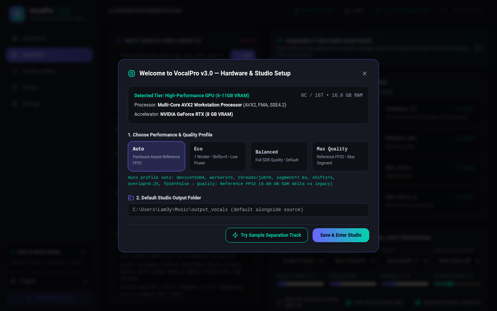

---

## 2. شاشة الفصل الرئيسية وطابور العمل (Separate Screen)

تنقسم منطقة العمل في شاشة **Separate** إلى لوحة إدخال الملفات، واختيار وضع الفصل والنموذج وجودة المعالجة، وشريط الطابور والمراقبة:

| الحالة | الوصف | اللقطة |
|---|---|---|
| **جاهزة مع ملف محمّل** | عرض تفاصيل الملف، المعاينة الموجية السريعة، وخيارات النموذج والتصدير | 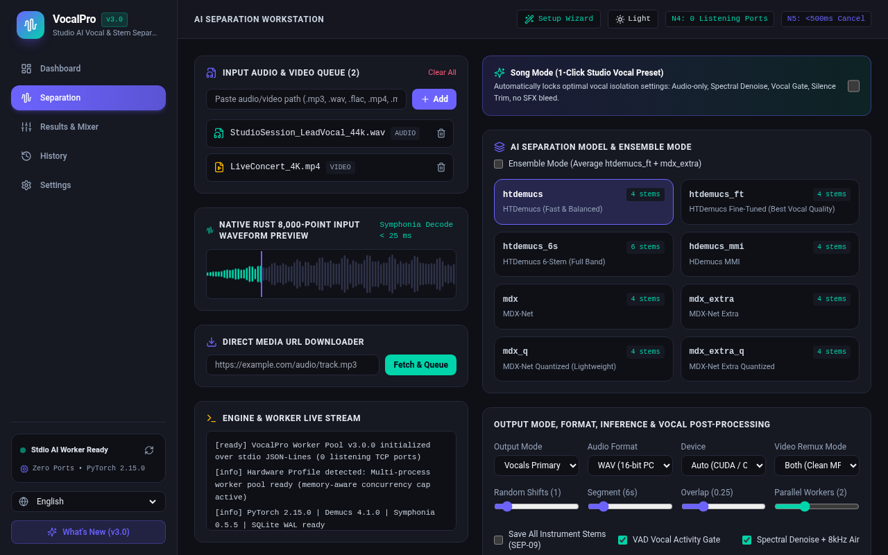 |
| **الحالة الفارغة (Empty State)** | منطقة السحب والإفلات الواضحة لبدء استيراد الصوت أو الفيديو | 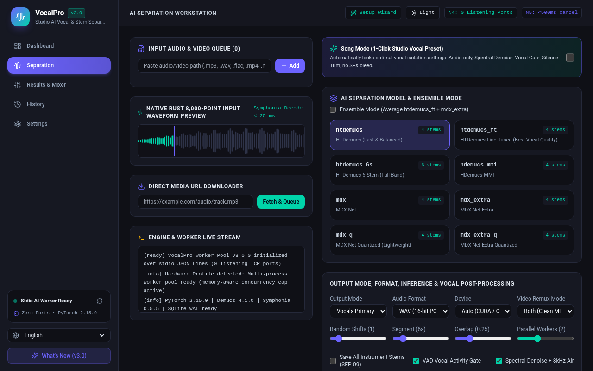 |
| **أثناء معالجة دفعة (Batch Queue)** | شريط تقدم حي لكل ملف، عرض المرحلة الحالية، وزر الإلغاء الفوري | 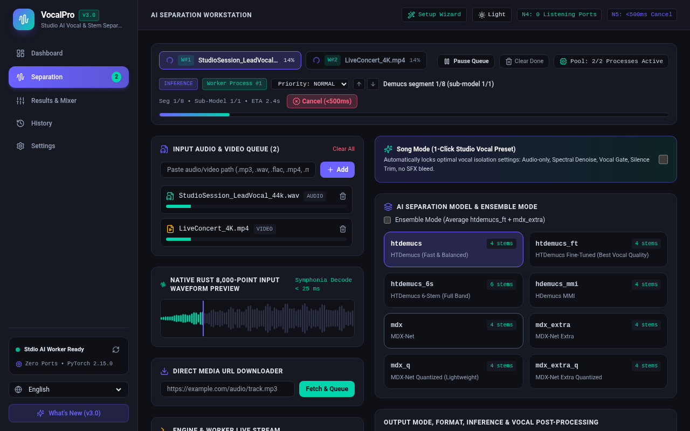 |
| **معالجة الأخطاء الواضحة** | عزل خطأ الملف الفاسد دون تعطيل باقي ملفات الطابور مع إشعار واضح | 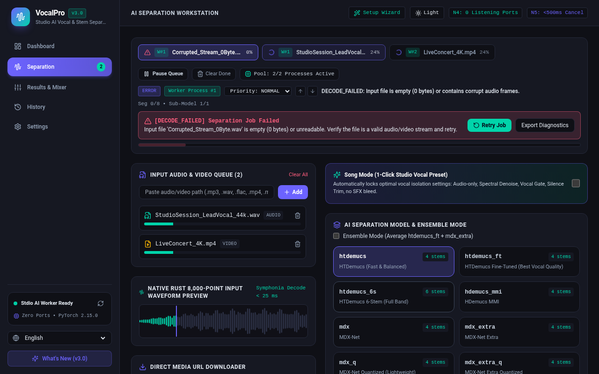 |

---

## 3. شاشة النتائج والميكسر الحي بـ 6 قنوات (Results & 6-Stem Mixer)

بعد انتهاء الفصل، تتيح لك شاشة **Results** تشغيل جميع المسارات متزامنة بدقة، ومعاينة الشكل الموجي التفاعلي، واستخدام قنوات التحكم المستقلة (**Solo / Mute / Volume / Pan / EQ / Reverb / Pitch / Speed**)، بالإضافة إلى التصدير المباشر وتحويل المسار إلى **MIDI**.

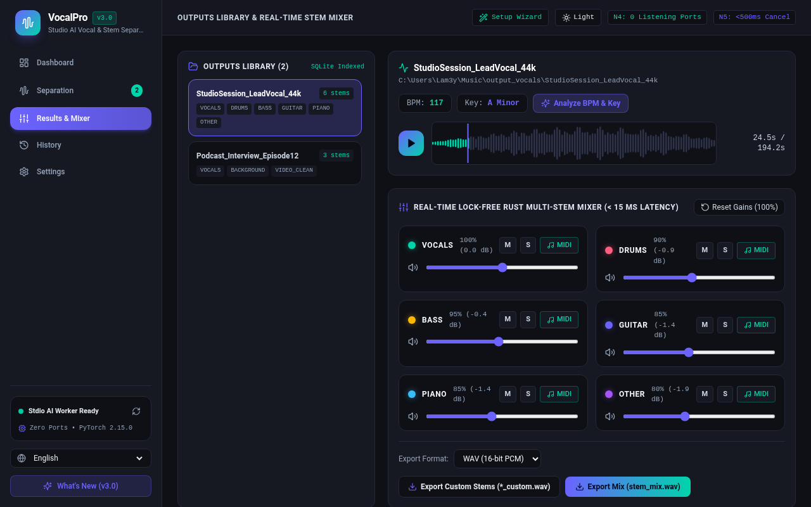

---

## 4. شاشة السجل (History Screen)

تحفظ قاعدة البيانات المحلية (**SQLite WAL**) سجل جميع الملفات المفصولة مع روابط مجلدات الإخراج وإمكانية إعادة فتح النتيجة في الميكسر أو تصديرها لاحقاً بضغطة واحدة.

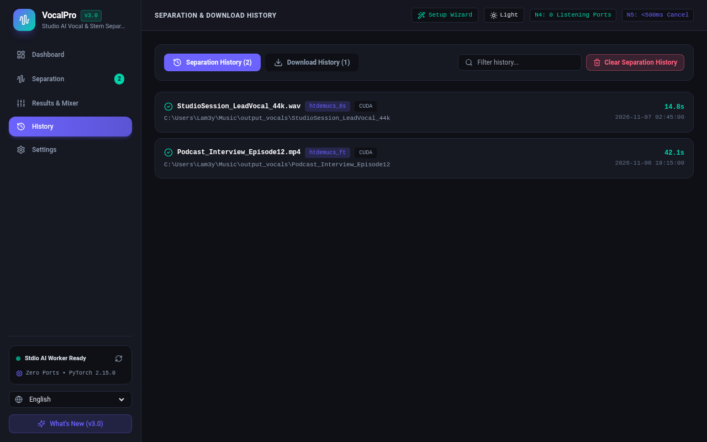

---

## 5. شاشة الإعدادات (Basic & Advanced Settings)

توفر شاشة **Settings** وضعين للعرض حسب حاجتك:
- **الوضع المبسط (Basic):** تغيير المجلد الافتراضي، اللغة، المظهر، صيغة التصدير، والمستوى العام للجودة.
- **الوضع المتقدم (Advanced):** ضبط `Shifts`، و`Segment Duration`، و`Overlap`، وسلسلة المعالجة البعدية `DSP`، ومسار `FFmpeg`، وتحميل النماذج للعمل Offline، وربط صيغ الملفات مع ويندوز.

| الإعدادات المبسطة | الإعدادات المتقدمة |
|---|---|
| 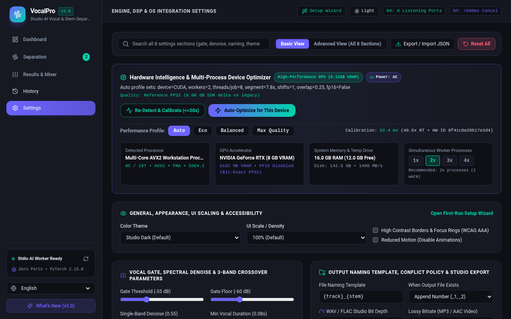 | 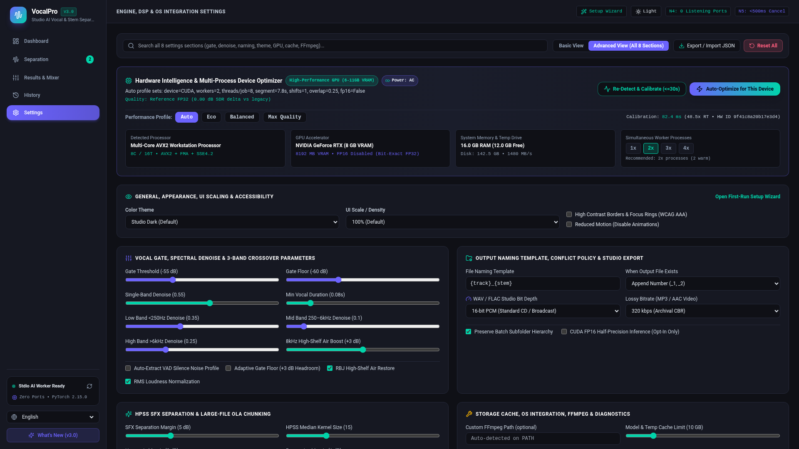 |

> لشرح كل معامل تقني داخل الإعدادات مع أمثلة عملية، راجع [دليل الإعدادات المتقدمة](SETTINGS_GUIDE.md).

---

## 6. الثيمات وتعدد اللغات (Light/Dark Themes & Arabic RTL)

يدعم التطبيق التبديل الفوري بين المظهر الداكن والفاتح و**16 لغة** من بينها **الواجهة العربية الكاملة من اليمين إلى اليسار (RTL)**:

| المظهر الفاتح (Light Theme) | الواجهة العربية الكاملة (Arabic RTL) |
|---|---|
| 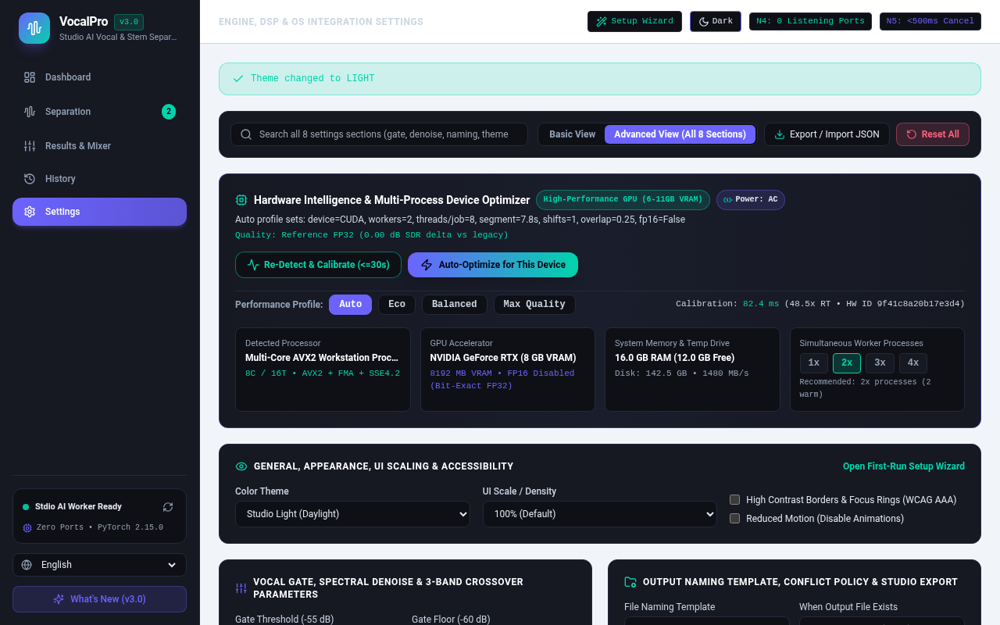 | 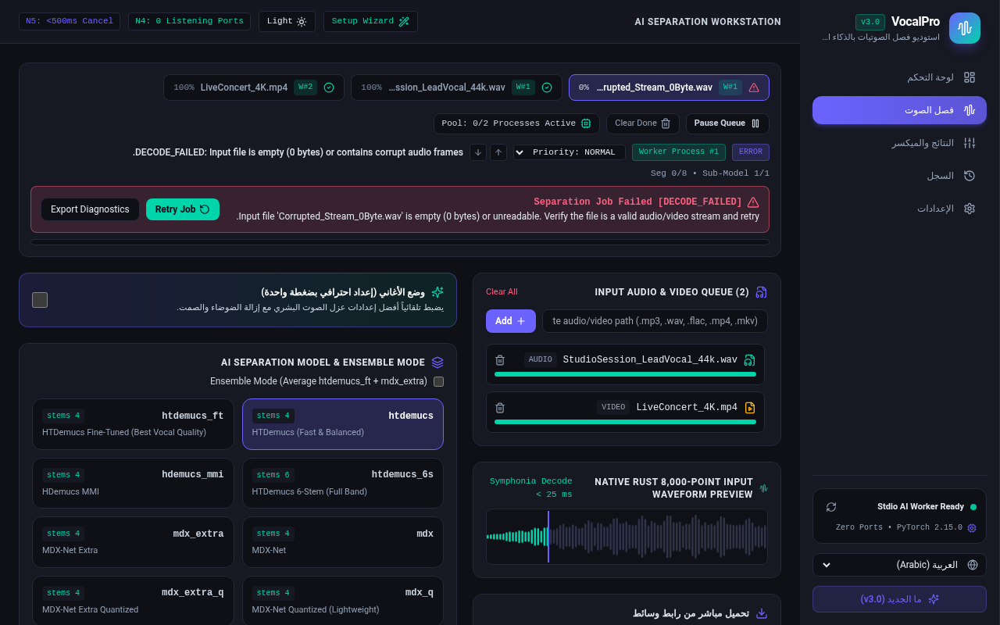 |
